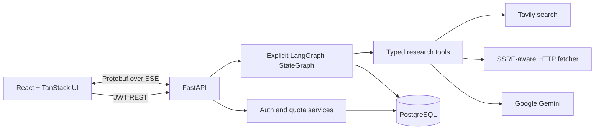

# Compass Intelligence

Compass Intelligence is a full-stack, evidence-first company and competitor research agent. It resolves a company identity, gathers primary and recent sources, discovers direct and indirect alternatives, normalizes product and pricing information, verifies report claims, and persists a reusable decision dossier.

The application is designed for founders, product marketers, strategy teams, consultants, investors, and corporate-development analysts. Earlier assistant statements are treated as conversation context, never as evidence.

## What is implemented

- JWT registration, login, recovery, account settings, and administrator user management
- Per-user standard and upgraded-model daily quotas with transactional research-run creation
- Tenant-isolated workspaces, companies, conversations, branches, evidence, reports, and comparisons
- Explicit LangGraph `StateGraph` with parallel research branches and a bounded evidence-gap loop
- Gemini model adapter, Tavily search adapter, safe HTTP retrieval, and deterministic test providers
- Typed Protobuf events transported as base64 payloads over SSE
- Persisted stage/tool timelines with per-tool duration
- Streaming React research interface, Markdown, GFM, KaTeX, citations, matrices, and branching
- Persisted BM25 dialogue recall, recent-pair context, entity/topic extraction, and conversation summaries
- Alembic migrations, PostgreSQL deployment, SQLite integration isolation, Docker, SMTP, and Sentry hooks
- OpenAPI client and Protobuf browser-schema generation workflows

Tracked-company monitoring schedules are not yet implemented; tracking currently preserves companies and preferences for future runs. See [known limitations](docs/known-limitations.md).

## Architecture



Detailed boundaries and data flow are in [docs/architecture.md](docs/architecture.md). The graph topology is documented in [docs/langgraph.md](docs/langgraph.md).

## Local setup

Requirements: Python 3.12, `uv`, Node.js 24, npm, and PostgreSQL 17.

```bash
cp .env.example .env
# Replace every placeholder in .env. Do not commit it.
uv sync --project backend
npm ci
cd backend && uv run alembic upgrade head && cd ..
```

Run the services in separate terminals:

```bash
cd backend && uv run uvicorn app.main:app --reload
npm --workspace frontend run dev
```

Open `http://localhost:5173`. To create the first administrator, explicitly provide one-time credentials; the command has no default password:

```bash
cd backend
INITIAL_SUPERUSER_EMAIL=admin@example.com \
INITIAL_SUPERUSER_PASSWORD='replace-with-a-strong-one-time-password' \
uv run python -m app.bootstrap_admin
```

## Deterministic local mode

Set `PROVIDER_MODE=deterministic` to exercise the real API, database, graph, SSE transport, persistence, and UI without Gemini or Tavily calls. Production should use `PROVIDER_MODE=live` with `GEMINI_API_KEY` and `TAVILY_API_KEY`.

## Docker development and production

After creating `.env` with non-default database values:

```bash
docker compose up --build
docker build -t compass-intelligence:local .
```

The migration service upgrades an empty PostgreSQL database before the backend starts. Development exposes the UI on port 5173 and API on port 8000. The production image serves the compiled React SPA from FastAPI. See [deployment documentation](docs/deployment.md).

## Verification

```bash
cd backend
uv run ruff format --check .
uv run ruff check .
uv run mypy app
uv run pytest -q
cd ..

npm --workspace frontend run lint
npm --workspace frontend run build
npm --workspace frontend run test:e2e
```

All tests are integration tests. Normal runs use deterministic providers and never require live Gemini or Tavily access. See [testing documentation](docs/testing.md).

## Generated contracts

```bash
npm --workspace frontend run generate:proto
./scripts/generate-client.sh
```

The Protobuf command generates the browser schema from the canonical `.proto`. The OpenAPI command generates a typed client under the ignored generated-client directory so teams can choose whether to commit it.

## Documentation

- [Architecture](docs/architecture.md)
- [LangGraph topology](docs/langgraph.md)
- [Tool contracts](docs/tools.md)
- [Evidence and citation model](docs/evidence.md)
- [Security](docs/security.md)
- [Testing](docs/testing.md)
- [Deployment](docs/deployment.md)
- [Known limitations](docs/known-limitations.md)

