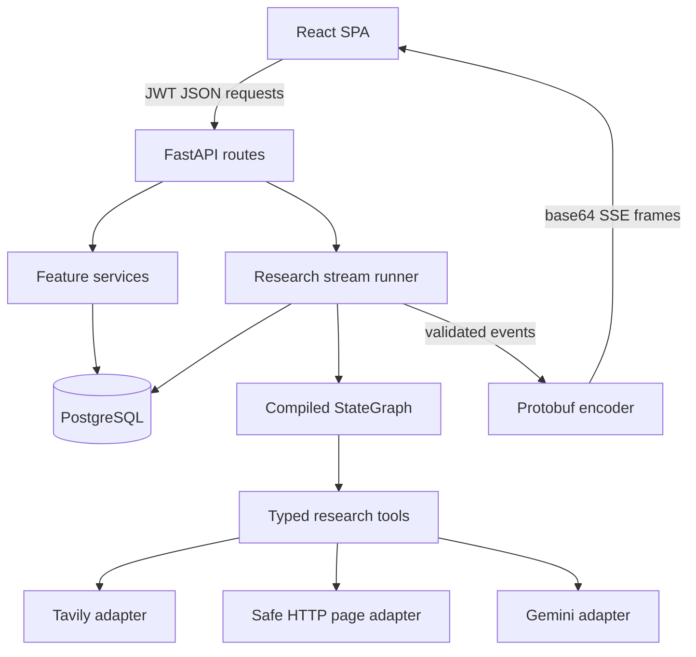
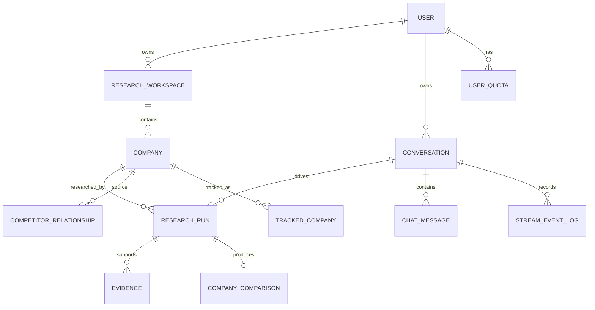

# Architecture

Compass Intelligence is a single repository with a FastAPI API, React SPA, canonical Protobuf contract, and PostgreSQL persistence.

## Backend boundaries

Feature packages own their models, schemas, services, and routers. Routes validate and authorize, then delegate to services. Domain errors are translated centrally. All database access uses SQLModel sessions and Alembic-managed tables; production does not call `create_all`.

Every owned lookup includes the authenticated user directly or joins through an owned workspace/run. LangGraph receives a `ResearchToolContext` containing the authenticated user, workspace, conversation, and run IDs. Tools never discover a user from global data.

Research-run creation locks and consumes the relevant quota in the same database transaction that creates the run. The stream runner executes the graph in a worker, emits live typed events, and persists the event ledger independently as events are delivered.

After every completed graph node, the run stores a typed JSON checkpoint, last completed stage, and next resumable stage. Retryable provider exhaustion marks the same run `PAUSED`; resuming reuses its quota, conversation, cached source/profile outputs, and evidence drafts.

## Context management

The context engine always emits the system instruction first. It retains recent dialogue pairs, uses BM25 to recall relevant older turns, extracts company/domain/topic terms, and persists a model-generated conversation summary after the configured threshold. Recalled assistant content is labelled `ASSISTANT_CONTEXT_NOT_EVIDENCE` and cannot satisfy citation verification.

## Frontend boundaries

TanStack Router owns public and authenticated routes. TanStack Query owns server state. The research page uses a buffered POST/SSE reader that handles CRLF and complete event records before decoding Protobuf. A discriminated event union updates stage, tool, source, evidence, gap, comparison, and dossier views.

Markdown rendering does not enable raw HTML. Evidence links are intercepted and fetched through authenticated APIs before opening the citation dialog.

## Persistence model

