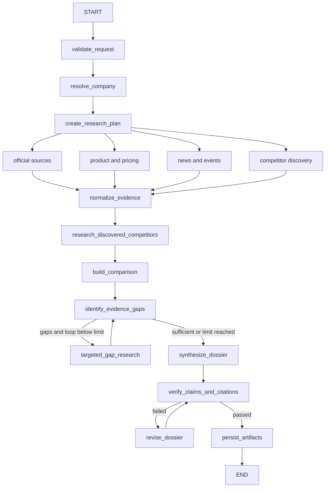

# LangGraph topology

The application compiles an explicit `StateGraph`; it does not use a prebuilt ReAct loop.

Every stage wrapper persists its merged state update. A retryable provider failure saves the failed stage and returns a paused stream event. `POST /research-runs/{id}/resume` re-enters the graph at that stage; failures in the initial parallel fan-out restart only the parallel research phase so the join remains valid.

State contains authenticated IDs, objective, canonical identity, plan, sources, evidence drafts, profiles, competitor candidates, normalized comparison, risks, gaps, loop count, packed conversation context, report claims, verification output, and final artifact metadata.

Parallel branches update distinct state keys and join at `normalize_evidence`. The gap loop is bounded by `MAXIMUM_GAP_RESEARCH_LOOPS`. Each node emits stage start/end events. Tool execution emits its own start/end pair and measures only that tool's duration.

The system prompt is passed on every model call. Retrieved content is wrapped in explicit untrusted-source delimiters and is never treated as instructions.

